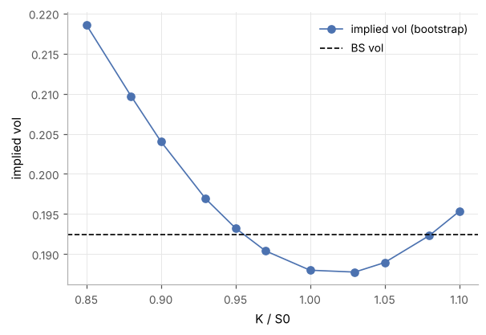

# Black-Scholes on the S&P 500: assumptions, pricing check, implied skew

European options priced with Black-Scholes, checked against Monte Carlo and a binomial tree, then confronted with 26 years of S&P 500 daily returns.



## Key results

| | Result |
|---|---|
| Implementation | Closed form, Monte Carlo and a 2,000-step CRR tree agree within 0.02 index points |
| Normality | Rejected: excess kurtosis 10.6, 46 days beyond 4 sd against 0.4 expected |
| Constant volatility | Rejected: 1-month vol from 3.5% (Oct 2017) to 97.6% (Apr 2020), squared returns autocorrelated for weeks |
| Effect on prices | With real returns, a 1-month put 15% out of the money is worth 3.7 times its Black-Scholes price |
| Implied vol | 21.9% at 85% of spot against 18.8% at the money: a skew Black-Scholes cannot produce |

## Data

| Series | Source | Period |
|---|---|---|
| S&P 500 daily close | yfinance (^GSPC) | 2000-01-03 to 2026-11-19, 6,761 log returns |

Pricing inputs: spot = last close (7,175.83), sigma = annualised historical vol since 2000 (19.24%), r = 3%, T = 21 trading days.

## Methodology

**Pricers** (`pricing.py`): closed-form Black-Scholes; Monte Carlo with exact GBM terminal prices, 1,000,000 paths and antithetic variates; Cox-Ross-Rubinstein tree with 2,000 steps; implied volatility by Brent's method.

**Assumption tests**: Jarque-Bera and Kolmogorov-Smirnov on daily log returns, count of 4-sigma days against the normal law, 21-day rolling volatility, autocorrelation of returns and squared returns.

**Real-return reference**: 200,000 one-month paths built by drawing 21 daily returns from the 2000-2026 history (iid bootstrap), centred, with a martingale correction so the discounted expected price equals the spot. Each bootstrap price is inverted into a Black-Scholes implied volatility.

## Results

### Assumptions (`01`)

| Test | Value | Normal law |
|---|---|---|
| Skewness | -0.35 | 0 |
| Excess kurtosis | 10.64 | 0 |
| Jarque-Bera p-value | 0.0 | |
| Kolmogorov-Smirnov p-value | 6.2e-52 | |
| Days beyond 4 sd | 46 | 0.4 |
| Worst day | -12.8% (16 Mar 2020), -10.6 sd | |

### Pricing check (`02`), 1-month options

| K / S0 | Type | Black-Scholes | Monte Carlo (95% CI) | CRR |
|---|---|---|---|---|
| 0.95 | call | 410.12 | 410.23 [409.55, 410.91] | 410.13 |
| 0.95 | put | 34.31 | 34.39 [34.19, 34.59] | 34.32 |
| 1.00 | call | 167.92 | 168.16 [167.67, 168.64] | 167.90 |
| 1.00 | put | 150.00 | 150.21 [149.78, 150.64] | 149.98 |
| 1.05 | call | 46.21 | 46.32 [46.06, 46.58] | 46.22 |
| 1.05 | put | 386.19 | 386.27 [385.63, 386.91] | 386.20 |

Black-Scholes is inside every Monte Carlo interval. Both references share its assumptions, so this validates the code, not the model.

### Real returns (`03`)

| K / S0 | Type | Bootstrap | Black-Scholes | Ratio | Implied vol |
|---|---|---|---|---|---|
| 0.85 | put | 0.58 | 0.16 | 3.74 | 21.9% |
| 0.90 | put | 5.28 | 3.74 | 1.41 | 20.4% |
| 0.95 | put | 34.72 | 34.31 | 1.01 | 19.3% |
| 1.00 | call | 164.26 | 167.92 | 0.98 | 18.8% |
| 1.05 | call | 44.14 | 46.21 | 0.96 | 18.9% |
| 1.10 | call | 8.83 | 8.19 | 1.08 | 19.5% |

## Limitations

- The bootstrap draws days independently: volatility clustering is lost and the skew is flatter than on real index options.
- No option market data: the skew is the one implied by historical returns, not by quotes.
- Constant rate (3%) and no dividends.

## Reproducing

```
pip install -r requirements.txt
pytest                 # 3 tests: known value, Monte Carlo and CRR agreement, implied vol round trip
jupyter notebook       # notebooks in order, plots use quant.mplstyle
```

| Notebook | Content | Runtime |
|---|---|---|
| `01_assumptions` | Normality and volatility tests | < 10 s |
| `02_pricing_check` | Black-Scholes vs Monte Carlo vs CRR | < 10 s |
| `03_bootstrap_skew` | Prices from real returns, implied vol | < 10 s |

Each notebook opens in Colab from its badge.
