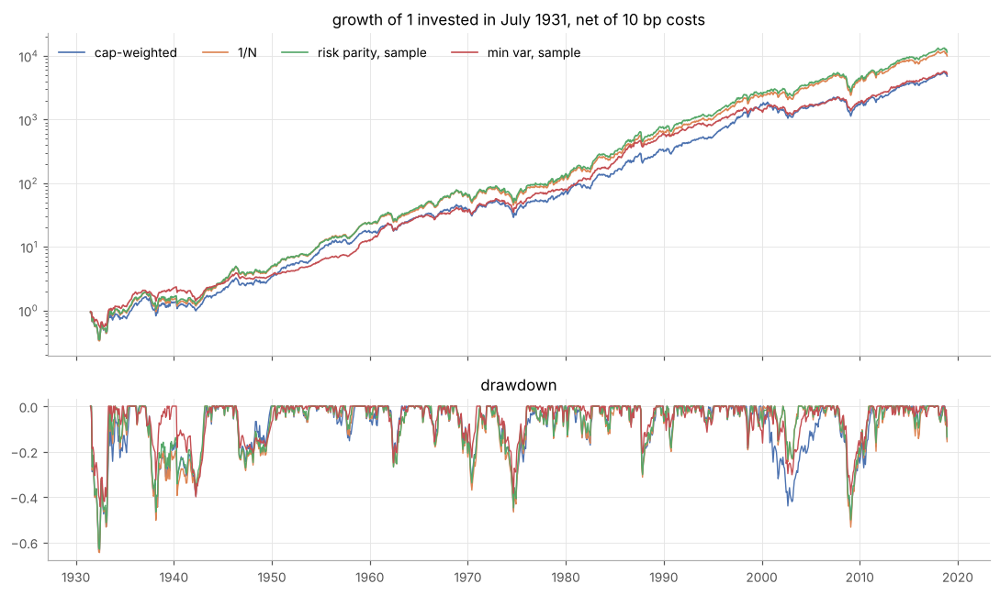

# Allocation across 30 US industries, 1931-2018: estimated risk vs 1/N

Out-of-sample test of risk-based allocations on Kenneth French's 30 industry portfolios: equal weights, market weights, minimum variance and risk parity, with sample and Ledoit-Wolf shrinkage covariances, transaction costs, Fama-French attribution and Sharpe ratio tests.



## Key results

| | Result |
|---|---|
| Best Sharpe ratio | Long-only minimum variance: 0.55 against 0.47 for 1/N and 0.45 for the market |
| Significance | No. Over 87 years, min variance vs 1/N gives p = 0.23 (Jobson-Korkie / Memmel) |
| Where the gain comes from | Lower risk, not higher return: vol 13.4% vs 19.1%, max drawdown -44% vs -64%, market beta 0.60, Fama-French alpha 2.7%/yr (t = 3.2) |
| Shrinkage | Ledoit-Wolf does not help long-only (0.53 vs 0.55) but lifts long-short min variance from 0.32 to 0.45 and cuts its turnover from 14.6 to 3.9 per year |
| Why | The no-short constraint already acts as shrinkage (Jagannathan and Ma 2003) |
| 1/N vs market | 1/N slightly ahead (0.47 vs 0.45), not significant (p = 0.20) |

## Data

| Series | Source | Period |
|---|---|---|
| 30 industry portfolios, value-weighted monthly returns | Kenneth R. French Data Library | 1926-07 to 2018-12 |
| Industry size and number of firms (for market weights) | same | same |
| Fama-French factors Mkt-RF, SMB, HML and risk-free rate | same | same |

1,110 months, no missing values. Industry vols from 16% (telecoms) to 37% (coal) a year, average pairwise correlation 0.65.

## Methodology

- **Out of sample.** At the start of each month the weights use only the previous 60 months. Backtest from 1931-07 (1,050 months).
- **Costs.** Holdings drift with prices during the month; moving back to the target costs 10 bp per unit traded.
- **Covariance.** Sample covariance, or Ledoit and Wolf (2004) shrinkage towards a constant-correlation matrix with the optimal intensity (average 0.53, from 0.09 to 1.0 over time).
- **Strategies.** 1/N; market weights from last month's caps; minimum variance long-only and long-short; risk parity (equal variance contributions, Spinu 2013).
- **Evaluation.** Annualised return, vol, Sharpe ratio over the risk-free rate, max drawdown, turnover; Fama-French 3-factor regression with Newey-West t-stats (6 lags); Jobson-Korkie test with Memmel's correction for Sharpe differences.

Everything is implemented in `alloc.py` (no portfolio library).

## Results (1931-07 to 2018-12, net of 10 bp)

| Strategy | Return | Vol | Sharpe | Max DD | Turnover/yr | FF3 alpha (t) | Market beta |
|---|---|---|---|---|---|---|---|
| 1/N | 12.4% | 19.1% | 0.47 | -64.5% | 0.33 | 0.3% (0.6) | 0.99 |
| Market weights | 11.4% | 18.0% | 0.45 | -63.6% | 0.43 | 0.1% (1.0) | 1.00 |
| Min variance, sample | 10.7% | 13.4% | 0.55 | -44.4% | 1.34 | 2.7% (3.2) | 0.60 |
| Min variance, Ledoit-Wolf | 10.4% | 13.4% | 0.53 | -44.3% | 1.20 | 2.4% (2.8) | 0.60 |
| Risk parity, sample | 12.3% | 17.8% | 0.50 | -63.0% | 0.39 | 0.9% (2.0) | 0.93 |
| Risk parity, Ledoit-Wolf | 12.3% | 18.0% | 0.50 | -63.2% | 0.36 | 0.7% (1.8) | 0.94 |
| Min variance long-short, sample | 8.2% | 15.3% | 0.32 | -52.4% | 14.57 | 2.3% (1.5) | 0.36 |
| Min variance long-short, Ledoit-Wolf | 8.9% | 12.7% | 0.45 | -49.1% | 3.94 | 3.5% (2.9) | 0.40 |

**Crises** (cumulative return):

| Period | Market | 1/N | Risk parity | Min variance |
|---|---|---|---|---|
| Mar 1937 - Mar 1938 | -49.5% | -50.3% | -46.7% | -32.1% |
| Jan 1973 - Sep 1974 | -46.0% | -46.7% | -44.8% | -38.4% |
| Sep 2000 - Sep 2002 | -44.0% | -20.1% | -17.4% | -26.2% |
| Nov 2007 - Feb 2009 | -50.1% | -53.3% | -50.1% | -39.0% |

Min variance loses least in three of the four crises, but not in the 2000-02 tech bust. It holds a median of 5 industries, mainly telecoms (32% on average) and utilities (20%): a concentrated, defensive portfolio. Risk parity stays close to 1/N because the industries have similar volatilities.

Min variance has the best risk-adjusted return but ends with less wealth than 1/N and risk parity: its return is lower.

## Limitations

- Industry portfolios are already diversified; results on single stocks would differ (more estimation error).
- One window length (60 months) and one cost level (10 bp).
- Sharpe tests assume roughly normal returns; the Fama-French alpha is significant while the Sharpe gain is not, so the two measures should be read together.
- Data ends in December 2018.

## Reproducing

```
pip install numpy pandas scipy matplotlib jupyter pytest
pytest                 # 6 tests: Ledoit-Wolf with right and wrong target, min variance, risk parity, backtest costs, Sharpe test size
jupyter notebook       # plots use quant.mplstyle
```

| Notebook | Content | Runtime |
|---|---|---|
| `01_data_and_covariance` | Data, correlation and shrinkage intensity over time | ~15 s |
| `02_allocation_backtest` | 8 strategies, Sharpe tests, Fama-French attribution, crises, holdings | ~2 min |

Data: Kenneth R. French Data Library, https://mba.tuck.dartmouth.edu/pages/faculty/ken.french/data_library.html
