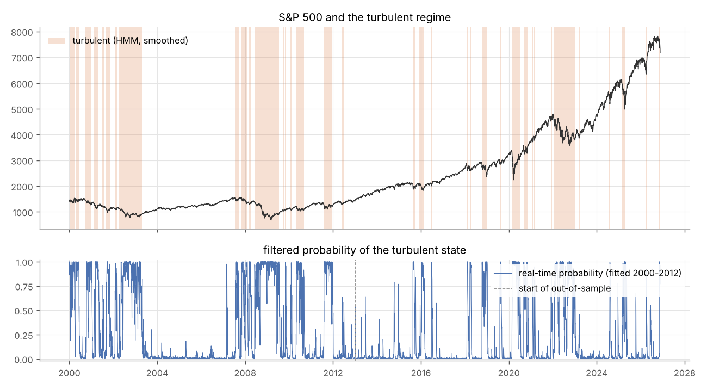

# Direction, regimes and pairs on the S&P 500, 2000-2026: signal or noise

Three popular ideas for beating the market, each tested against the right baseline: calling tomorrow's direction, detecting calm and turbulent regimes, and trading cointegrated pairs. A model always finds a pattern; the question is whether it survives out of sample, a proper test and trading costs.



## Key results

| Question | Answer | Main evidence |
|---|---|---|
| Can a model call tomorrow's direction? | No | Logistic 54.6%, random forest 53.3%, "always up" 54.5% (2010-2026). Paired test vs always-up: p = 0.70 and 0.06. Break-even trading cost 9.4 bp and 0.5 bp per switch |
| Are there calm and turbulent regimes? | Yes | HMM: vol 11% vs 31% a year, regimes last 85 and 35 days. Agrees with the VIX (corr. 0.74), with weekly data (89% of weeks) and appears in all six other assets |
| Can the regimes be traded? | Risk yes, return no | Out of the market when turbulent (2013-2026, real time): max drawdown -19% vs -34%, Sharpe 0.59 vs 0.57 (p = 0.93), break-even cost 2.8 bp |
| Do cointegrated pairs persist? | No | 43 same-industry pairs, 1,093 tests: a pass is followed by a pass 12.6% of the time vs 9.3% after a fail (Fisher p = 0.24). Same with Johansen and 2-3 year windows |
| Are same-industry pairs cointegrated at all? | Only over 3 years | 1-year pass rate 10.2%, below the 11.8% of the same pairs with no cointegration. With 3-year windows 21.6% vs 16.9% (p < 0.04) |

## Data

| Series | Source | Period |
|---|---|---|
| S&P 500 index, daily close | Yahoo Finance (`../black-scholes-sp500/data`) | 2000-01 to 2026-11 |
| Apple, Microsoft, JPMorgan, Exxon, GLD (gold), TLT (Treasuries) | Yahoo Finance, adjusted (`../var-es-sp500/data`) | 2000-01 to 2026-11 (GLD from 2004-11, TLT from 2002-07) |
| Bank of America, Coca-Cola, PepsiCo, Chevron, VIX, 13-week T-bill (^IRX) | Yahoo Finance (`data/`) | 2000-01 to 2026-11 |
| 80 more stocks forming 40 same-industry pairs (`data/pairs_close.csv`) | Yahoo Finance, adjusted, via `yfinance` | 2000-01 to 2026-11 (GM from 2010, V from 2008, MA from 2006) |

Daily log returns. The T-bill rate is the risk-free rate in every Sharpe ratio and what cash earns when a strategy is out of the market.

## Methodology

| | Direction (`01`) | Regimes (`02`) | Pairs (`03`) |
|---|---|---|---|
| Model | Logistic regression, random forest. Features at the close of t: 5 lagged returns, 21-day vol, 21 and 252-day momentum, distance from the 252-day high | 2-state Gaussian HMM by EM (scaled forward-backward); Gaussian mixture on 21-day return and vol; Student-t and 3-state HMMs by direct maximum likelihood, 5 starts each | Engle-Granger (OLS hedge ratio, Dickey-Fuller t of the residual) and Johansen trace test, on log prices |
| Out of sample | Refit every January on all past data, test 2010-2026 | Fitted on 2000-2012, filtered probabilities only after 2013 | Test in year y, test again in y + 1 (or the next 2-3 year window) |
| Baseline | "Always up", not 50% | Buy and hold; past 21-day vol as a vol forecast | Same pairs with no cointegration |
| Test | Exact McNemar on days where model and baseline disagree; Jobson-Korkie / Memmel for Sharpe ratios | Jobson-Korkie / Memmel; BIC across models; VIX as an outside check | Critical values simulated for each window length; block bootstrap of each pair's joint returns for the no-cointegration pass rate; Fisher exact test for persistence; simulated power |
| Costs | 5 and 10 bp per switch, break-even cost | same | none (no trading) |

All statistics are written in `signals.py` (HMM by EM and by direct likelihood, filter, McNemar, Engle-Granger, Johansen, simulated critical values, Sharpe test); scikit-learn only for the two classifiers and the Gaussian mixture.

## Results

### 1. Direction of tomorrow (test 2010-2026, 4,246 days)

| Model | Accuracy | Says "up" | Right when always-up is wrong / wrong when it is right | McNemar p | Sharpe | Trades/yr | Sharpe at 10 bp | Break-even |
|---|---|---|---|---|---|---|---|---|
| Always up (buy and hold) | 54.5% | 100% | | | 0.55 | 0 | 0.55 | |
| Logistic regression | 54.6% | 94% | 123 / 116 | 0.70 | 0.68 (p = 0.14) | 22 | 0.54 | 9.4 bp |
| Random forest | 53.3% | 84% | 318 / 368 | 0.06 | 0.57 (p = 0.86) | 54 | 0.23 (p < 0.01) | 0.5 bp |

- Against 50% both models would look significant (p < 0.001): the wrong question, since 54% of days are up.
- No stable edge: the forest beats always-up in 6 of 17 years (2014, 2016, 2020-22, 2024).
- The logistic model's small Sharpe gain disappears once all costs per switch reach about 9 bp; the forest loses below the spread of a liquid ETF.

### 2. Regimes

**Two-state model, S&P 500 2000-2026**

| | Vol %/yr | Mean %/day | Expected duration | Share of days |
|---|---|---|---|---|
| Calm | 11 | +0.08 | 85 days | 71% |
| Turbulent | 31 | -0.11 | 35 days | 29% |

| | Switches/yr | 2008 | 2017 | 2020 | 2022 |
|---|---|---|---|---|---|
| HMM (smoothed) | 3.3 | 79% | 0% | 55% | 97% |
| Gaussian mixture | 6.2 | 48% | 0% | 39% | 57% |
| HMM on weekly returns | | 79% | 0% | 50% | 90% |

The mixture classifies each day on its own and switches twice as often; the HMM uses the persistence of regimes. Weekly and daily models agree on 88.7% of weeks. Median VIX is 26 in the turbulent state and 16 in calm (correlation 0.74), although the VIX is never used in the fit.

**Model choice** (each fitted from 5 starting points; one start of the 2-state and one of the 3-state fit stop at a local optimum)

| HMM | Parameters | Log-likelihood | BIC | Vol or t scale %/day | Duration (days) |
|---|---|---|---|---|---|
| 2 Gaussian states | 6 | -9,519 | 19,091 | 0.70 / 1.94 | 84 / 36 |
| 2 Student-t states (nu 6.2 / 4.6) | 8 | -9,341 | 18,753 | 0.56 / 1.33 | 103 / 63 |
| 3 Gaussian states | 12 | -9,225 | 18,556 | 0.56 / 1.19 / 2.90 | 39 / 27 / 23 |
| 3 Student-t states (nu 7.4 / 43 / 6.1) | 15 | -9,188 | 18,508 | 0.50 / 1.15 / 2.24 | 48 / 30 / 29 |

The two-state Gaussian model is the simplest, not the best fit: three Student-t states (calm / normal / crisis) win on BIC.

**Other assets** (2-state HMM on each, daily)

| | Calm vol %/yr | Turbulent vol %/yr | 2008 | 2020 | 2022 | Corr. with S&P 500 regime |
|---|---|---|---|---|---|---|
| Apple | 24 | 68 | 77% | 34% | 24% | 0.49 |
| Microsoft | 18 | 50 | 71% | 49% | 66% | 0.66 |
| JPMorgan | 19 | 64 | 94% | 45% | 22% | 0.71 |
| Exxon | 18 | 44 | 52% | 82% | 68% | 0.56 |
| Gold (GLD) | 13 | 29 | 100% | 23% | 7% | 0.28 |
| Treasuries (TLT) | 10 | 20 | 55% | 36% | 100% | 0.46 |

2008 hits almost every asset; 2020 is mostly an oil shock for Exxon and 2022 a bond crash for Treasuries, while gold stays calm.

**Real time (fitted 2000-2012, used 2013-2026)**

| | Next-month vol after signal | Corr. with next-month vol | In the market | Return | Max drawdown | Sharpe | Break-even |
|---|---|---|---|---|---|---|---|
| Buy and hold | | 0.483 (past 21-day vol) | 100% | 11.5% | -33.9% | 0.57 | |
| Out when turbulent | 0.78%/day calm, 1.48%/day turbulent | 0.495 | 83% | 8.6% | -18.7% | 0.59 (p = 0.93) | 2.8 bp |

The real-time regime is mostly a smoothed version of recent vol. Switching out of the market halves the drawdown but does not raise the Sharpe ratio, and 8 switches a year at more than 2.8 bp each make it worse than buy and hold.

### 3. Pairs

**Pass rates and persistence**

| | Tests | Pass at 5% | Pass rate with no cointegration (bootstrap) | Pass next year, after a pass | after a fail | Fisher p |
|---|---|---|---|---|---|---|
| 21 mixed pairs (7 assets), 2005-2025 | 441 | 7.7% | 9.8% | 5.9% | 7.6% | 1.00 |
| 43 same-industry pairs, 2000-2025 | 1,093 | 10.2% | 11.8% | 12.6% (95% CI 7%-20%) | 9.3% | 0.24 |

- Real returns (fat tails, vol clustering, drifts) pass a test calibrated on Gaussian random walks about twice as often as the nominal 5%; only a bootstrap of the same returns gives the right comparison.
- With 1,093 tests the persistence test has 97% power against 25% vs 10% (simulated); the 95% interval 7%-20% rules that out.
- The strongest mixed "pairs" make no economic sense: Microsoft / gold in 2018 (t = -5.68, hedge ratio -1.76) ends 2019 at +24 sd. The best same-industry pairs, V/MA and NUE/STLD, pass 6 years out of 18 and 26.

**Window length and test** (43 same-industry pairs)

| Window | Test | Windows | Pass | No cointegration (bootstrap) | Bootstrap p | Next after pass / after fail | Fisher p |
|---|---|---|---|---|---|---|---|
| 1 year | Engle-Granger | 1,093 | 10.7% | 12.7% | 0.97 | 12.0% / 9.9% | 0.52 |
| 1 year | Johansen | 1,093 | 11.0% | 13.4% | 0.93 | 13.3% / 10.1% | 0.27 |
| 2 years | Engle-Granger | 503 | 16.9% | 15.7% | 0.17 | 15.3% / 17.5% | 0.75 |
| 2 years | Johansen | 503 | 16.1% | 15.4% | 0.30 | 12.3% / 14.2% | 0.73 |
| 3 years | Engle-Granger | 334 | 21.6% | 16.9% | < 0.04 | 16.7% / 19.8% | 0.61 |
| 3 years | Johansen | 334 | 18.9% | 14.3% | < 0.04 | 22.2% / 15.5% | 0.20 |

Over three years same-industry pairs do share a trend more often than chance, with both tests. But a link found in one window does not predict the next one: real, not tradable. The no-cointegration rate barely moves with the bootstrap block length (11.8% with 21 or 63-day blocks, 10.6% with one-year blocks).

## Limitations

- Costs: flat 5 and 10 bp per switch plus a break-even cost; no bid-ask quotes on Yahoo Finance for an explicit spread model, and taxes depend on the investor.
- Survivorship: pairs are current large caps; firms that failed or were taken over (Lehman, Bear Stearns, Wachovia) are missing. Fixing it needs delisted prices (CRSP).
- The 3-year bootstrap p-value rests on 30 histories (none reached the observed rate); more histories would give a sharper value.
- One regime model per asset; a joint multivariate HMM across assets not tried.

## Reproducing

```
pip install numpy pandas scipy scikit-learn matplotlib jupyter pytest
pytest                 # 7 tests: McNemar, no look-ahead in walk-forward, HMM on simulated regimes, HMM likelihood (EM vs direct fit), Engle-Granger and Johansen size and power, Sharpe test size
jupyter notebook       # plots use quant.mplstyle
```

| Notebook | Content | Runtime |
|---|---|---|
| `01_direction` | Walk-forward classifiers, McNemar test, results by year, Sharpe with costs, break-even | ~30 s |
| `02_regimes` | HMM by EM, Gaussian mixture, VIX, real-time filter and switch, 4 HMM specifications, other assets, weekly data | ~7 min |
| `03_pairs` | Simulated critical values, 21 mixed and 43 same-industry pairs, bootstrap nulls, power, 1-3 year windows, Johansen | ~4 min |
