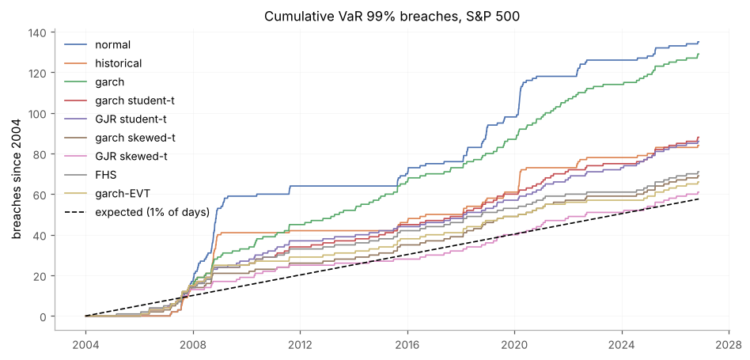

# VaR and Expected Shortfall: model backtests, portfolios, stress tests

One-day 99% VaR and ES for the S&P 500, a two-asset portfolio (S&P 500 + Apple) and a seven-asset portfolio (five stocks, gold, long Treasuries). 12 models, out-of-sample backtests 2004-2026, risk-parity allocation, transaction costs and stress tests.



## Key results

| | Result |
|---|---|
| Best single-asset model | GJR-GARCH with Hansen skewed-t errors: 1.06% breaches, passes Kupiec and Christoffersen |
| Normal VaR | 2.34% breaches on the S&P 500, ES 39% too small on breach days |
| What fixes it | Time-varying vol **and** an asymmetric tail. Either one alone fails a test |
| 10-day VaR | Simulated GJR skewed-t paths: 22% above the sqrt(10) rule on average, up to 70% in calm markets |
| Stock-bond correlation | -0.71 (2011) to +0.25 (2026). Since 2022 bonds no longer hedge stocks |
| Risk parity, out of sample | Monthly DCC weights: 11.4% return, 9.4% vol, ES 2.14% (S&P 500 alone: 4.68%) |
| VaR of risk-parity portfolios | No model passes the independence test: breaches cluster when the hedges fail (March 2020) |
| Stress | Dash for cash (9-18 March 2020): every portfolio loses 15.6-19.3%, risk parity included |

## Data

| Series | Source | Period | Notes |
|---|---|---|---|
| S&P 500 | yfinance (^GSPC) | 2000-01-03 to 2026-11-19 | `../black-scholes-sp500/data/sp500.csv` |
| AAPL, MSFT, JPM, XOM | yfinance | 2000-01-03 to 2026-11-20 | split and dividend adjusted |
| GLD (gold), TLT (20y+ Treasuries) | yfinance | from 2004-11-18 and 2002-07-30 | sets the start of the 7-asset sample |

Daily log returns. Two-asset sample: 6,761 days. Seven-asset sample: 5,535 days (2004-11-19 onwards).

## Methodology

**Backtest setup.** One-day-ahead VaR and ES at 99%. Each forecast only uses the previous 1,000 trading days. GARCH-type models are refitted every 250 days and filtered daily in between. A breach is a day where the loss exceeds the VaR.

**Tests.** Kupiec (breach rate = 1%), Christoffersen (breaches independent from one day to the next), and realised loss / predicted ES on breach days (1 = correct ES). A model passes at the 5% level.

**Models** (all fitted by maximum likelihood in `risk.py`, no external GARCH library):

| Model | Volatility | Tail |
|---|---|---|
| Normal | constant over the window | normal |
| Historical | constant over the window | empirical |
| GARCH | GARCH(1,1) | normal |
| GARCH student-t / GJR student-t | GARCH / GJR-GARCH | symmetric Student-t |
| GARCH skewed-t / GJR skewed-t | GARCH / GJR-GARCH | Hansen (1994) skewed t |
| FHS | GARCH(1,1) | empirical residuals |
| GARCH-EVT | GARCH(1,1) | generalised Pareto above the 90% quantile (McNeil and Frey 2000) |
| EWMA | RiskMetrics covariance, lambda 0.94 | normal |
| Multivariate FHS | one GARCH per asset | empirical joint residuals |
| DCC-FHS | GARCH per asset + DCC(1,1) correlation (Engle 2002) | empirical joint residuals |

**Portfolios.** Equal-risk weights: equal share of the historical ES (risk budgeting, Bruder and Roncalli) or of the variance (Spinu 2013). Out-of-sample versions recompute the weights yearly (ES, 1,000 days) or monthly (sample covariance of 250 days, or the DCC forecast). Portfolios drift between monthly rebalancings and pay 0-20 bp per unit traded.

## Results

### S&P 500 (`02`), 5,761 days, 58 breaches expected

| Model | Breaches | Kupiec | Christoffersen | Loss / ES |
|---|---|---|---|---|
| Normal | 2.34% | ✗ | ✗ | 1.39 |
| Historical | 1.46% | ✗ | ✗ | 1.07 |
| GARCH | 2.24% | ✗ | ✓ | 1.12 |
| GARCH student-t | 1.53% | ✗ | ✓ | 1.01 |
| GJR student-t | 1.49% | ✗ | ✓ | 1.01 |
| GARCH skewed-t | 1.20% | ✓ | ✓ (p = 0.06) | 1.01 |
| **GJR skewed-t** | **1.06%** | **✓** | **✓** | 1.05 |
| FHS | 1.23% | ✓ | ✓ | 1.03 |
| GARCH-EVT | 1.15% | ✓ | ✗ (p = 0.047) | 1.03 |

The residuals stay skewed after GARCH (-0.58): a symmetric t gives a 1% quantile of -2.55 against -2.75 in the data, the skewed t -2.74. GJR alone changes little (alpha ≈ 0, gamma = 0.21: only down days raise the vol) but, on top of the skewed t, makes the breaches independent.

### S&P 500 + Apple, 50/50 (`03`-`05`)

- Correlation between 0.2 (2014) and 0.9 (May 2020). On the worst 1% of days both fall 28% of the time against 20% for a Gaussian copula; a t copula with ν ≈ 4.5 fits better.
- Diversification cuts the 99% VaR by 13% only. Apple brings 68% of the ES with 50% of the capital (36% in Apple for equal ES).
- Backtest: normal, GARCH and EWMA at 1.8-1.9%, rejected. Passing both tests: GARCH student-t (1.18%), GJR student-t (1.25%), GARCH skewed-t (1.02%), GJR skewed-t (1.04%), DCC-FHS (1.20%). FHS, EVT and multivariate FHS pass outside 2008 only (1.03-1.09% without it).

### 10-day horizon (`06`), 576 non-overlapping periods, 5.8 breaches expected

| | S&P 500 | 50/50 portfolio |
|---|---|---|
| Normal × sqrt(10) | 9 | 13 ✗ |
| GJR skewed-t × sqrt(10) | 9 | 6 |
| GJR skewed-t, simulated paths | 6 | 4 |

Low power: 9 breaches still gives Kupiec p = 0.21.

### Seven assets (`07`-`09`), backtest from 2008-11 (4,535 days)

- Equal weights: JPM alone brings 28% of the ES, bonds reduce it. Only GJR skewed-t (0.95%), FHS and GARCH-EVT pass both tests.
- Allocation, 2009-2026, monthly rebalancing with drift, before costs:

| Weights | Return | Vol | ES 99% | 2022 | Turnover / yr | Return at 20 bp |
|---|---|---|---|---|---|---|
| 1/7 | 14.4% | 14.1% | 3.47% | -8.1% | 0.45 | 14.4% |
| Equal ES, yearly | 9.3% | 9.7% | 2.24% | -17.6% | 0.52 | 9.2% |
| Risk parity, monthly sample | 10.3% | 9.6% | 2.31% | -11.5% | 0.55 | 10.2% |
| Risk parity, monthly DCC | 11.4% | 9.4% | 2.14% | -10.8% | 1.66 | 11.1% |

- VaR of the two out-of-sample risk-parity portfolios: no model passes Christoffersen (p ≤ 0.02) and the ES is 4-31% too small. Both have 4 breaches in March 2020; without that month the DCC portfolio is at 1.03% but still clustered (p = 0.012).

### Stress tests (`10`), today's weights

| Loss | S&P 500 | 1/7 | Equal ES | Monthly DCC |
|---|---|---|---|---|
| Lehman, 15 Sep - 15 Oct 2008 | -27.5% | -13.5% | -5.6% | -12.3% |
| Covid crash, 19 Feb - 23 Mar 2020 | -33.6% | -24.1% | -11.7% | -19.3% |
| Dash for cash, 9 - 18 Mar 2020 | -19.3% | -17.7% | -15.6% | -18.0% |
| 2022, 3 Jan - 14 Oct | -24.8% | -11.6% | -15.6% | -9.7% |

Correlation stress at today's volatilities: moving the stock / hedge correlations from the 2009-2021 regime (stock-bond -0.35) to today's (+0.04) raises the risk-parity VaR by 17-31%, to a crisis state by 52-85%. Even then the 10-day VaR (6-7%) is far below the dash-for-cash loss: stock and bond volatilities were 4.6-9.3 times today's.

## Limitations

- Two to seven assets, long-only, daily data; no intraday or liquidity effects.
- Window (1,000 days) and refit frequency (250 days) set by hand, not optimised.
- Up to twelve models tested on the same data: some passes can be luck.
- 10-day tests have about six expected breaches, so little power.
- The seven-asset backtest starts in November 2008 (GLD history) and misses most of the 2008 crash.
- Crisis correlation (+0.6) in the stress test is a choice, not an estimate.

## Reproducing

```
pip install numpy pandas scipy matplotlib jupyter pytest
pytest                 # 25 tests on simulated data, ~45 s
jupyter notebook       # notebooks in order, all plots use quant.mplstyle
```

| Notebook | Content | Runtime |
|---|---|---|
| `01_sp500_tails` | Fat tails, GARCH fit, EVT on the residuals | < 10 s |
| `02_sp500_backtest` | 9 models on the S&P 500 | ~20 s |
| `03_portfolio_dependence` | Correlation over time, DCC, t copula | < 10 s |
| `04_portfolio_backtest` | 12 models on the 50/50 portfolio | ~40 s |
| `05_risk_weights` | Diversification, ES contributions, equal-risk weights | < 10 s |
| `06_ten_day_horizon` | sqrt(10) rule vs simulated paths | ~3.5 min |
| `07_seven_assets` | Correlations, stock-bond regime, 11-model backtest | ~40 s |
| `08_yearly_weights` | Out-of-sample weights: yearly ES, monthly sample, monthly DCC | ~1 min |
| `09_costs_and_var` | Transaction costs, VaR of the risk-parity portfolios | ~3 min |
| `10_stress_tests` | Historical scenarios, correlation stress | ~1 min |

Each notebook opens in Colab from its badge.
